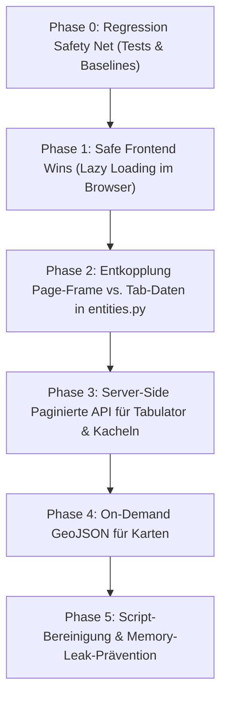

# Refactoring- & Optimierungsplan: Entities-Browsing & RAM-Reduktion

> **Ziel**: Senkung des RAM-Verbrauchs von ~1,4 GB auf unter 150 MB im Browser und von ~420 MB auf unter 100 MB im Flask-Backend beim Aufruf von `/entities`, **ohne** bestehende Funktionalitäten (Filter, Suche, Zeitleiste, Karte, Kacheln, Einzeldarstellung, Subunits) zu brechen.

---

## 1. Ausgangslage & Problem-Analyse

### 1.1 Warum verbraucht die Website bis zu 1,4 GB RAM?
Beim Aufruf der Route `/entities` laufen mehrere Kaskadeneffekte ab:

1. **Monolithischer Daten-Dump (`entities.py` -> `entity.html`)**:
   * Die Funktion `get_browse_list_entities(0)` führt `db_entities.get_entities_list()` und `db_entities.get_geometries()` ohne Paginierung aus.
   * Aktueller Stand der Datenbank: **64.660 Entitäten** und **9.066 GeoJSON-Features**.
   * Die Daten werden per `{{ data | tojson }}` ungefiltert direkt in das HTML-Dokument serialisiert.
   * Das resultierende HTML-Dokument ist **~27,8 MB groß** (davon ~23 MB rohes JSON).
2. **Speicher-Explosion im Browser (V8 Engine)**:
   * Das Parsen des 23 MB JSON erzeugt 64.660 vollwertige JS-Objekte im V8-Heap (~180 MB).
   * Eine `forEach`-Schleife in `entity.html` erzeugt für alle 64.660 Entitäten zusätzliche Felder und verkettete Volltext-Strings (`entity.all = [description, class, type, name].join(' ')`), was zehntausende neue String-Allokationen bewirkt (+80 MB).
3. **Eager Loading aller 7 Tabs gleichzeitig**:
   * `entity.js` lädt beim Seitenaufruf nicht nur den aktiven Tab, sondern feuert sofort parallele AJAX-Requests für **alle 7 Tabs** (`places`, `features`, `items`, `actors`, `events`, `sources`, `files`).
   * Jeder Tab lädt das Template `tabs/browse.html` nach und initialisiert:
     * Eine eigene **Tabulator-Tabelle** mit `pagination: "local"` (alle 64.660 Zeilen verbleiben im Speicher, z. B. 24.651 Einträge in `items`, 20.834 in `files`).
     * `places` und `items` initialisieren jeweils eine separate **MapLibre-GL Karte (WebGL Context)** und laden alle 9.066 Geometrien in den Grafikspeicher.
     * `items` und `features` schalten automatisch auf die Kachelansicht (Muuri) um und starten den Download von IIIF-Bildern.
   * Über 15.000 Zeilen inline-JavaScript werden redundant in den DOM injiziert und registrieren unzählige globale Event-Listener (`window.resize`, `document.change`).
4. **Backend-Memory-Retention (Flask / Python)**:
   * Python baut für 64.660 Zeilen Dictionaries auf und Jinja2 erzeugt den 28 MB HTML-String.
   * Pythons Memory Allocator (`pymalloc`) gibt freigewordene Speicher-Arenas selten direkt an das Betriebssystem zurück. Der Flask-Worker bleibt bei **> 420 MB RSS** stehen.

---

## 2. Architektonische Leitplanken & Verträge (Contracts)

### 2.1 Unverzichtbare Abhängigkeiten (Wo `entities.py` verwendet wird)
`histarchexplorer/views/entities.py` hat zwei zentrale Einstiegspunkte:
1. `return_entities(tab_name, id_)`:
   * Wird aufgerufen von:
     * `/entities`
     * `/entities/<tab_name>`
     * `/entities/<tab_name>/<int:id_>`
2. `get_browse_list_entities(id_)`:
   * Wird aufgerufen von `return_entities` (mit `id_=0`).
   * **ACHTUNG**: Wird auch von `histarchexplorer/views/entity.py` in `get_entity(id_, tab_name='subunits')` aufgerufen (mit `id_ > 0`)!
   * Für `id_ > 0` werden nur die direkten Untereinheiten (`P46`-Relation) geladen. Hier ist die Datenmenge klein (typischerweise < 100 Einträge).

### 2.2 Bestehende Tests & Safeguards
* `tests/test_entities.py`: Prüft Status 200 für `/entities`, `/entities/places`, `/get_entities/places`.
* `tests/test_entity_views.py`: Prüft u. a. die Subunits-Verlinkung und mockt `get_browse_list_entities`.
* **Regel**: Alle bestehenden 429 Tests müssen vor, während und nach jedem Schritt grün bleiben (`uv run pytest`).

---

## 3. Phasen-Roadmap (Reihenfolge der Umsetzung)

Die Umstellung erfolgt nach dem Prinzip **"Sicherheit zuerst, minimales Risiko vor Tiefen-Refactoring"**. 
Jede Phase ist eine in sich geschlossene Einheit mit klaren Akzeptanzkriterien.



---

### Phase 0: Regression Safety Net & Baselines

Bevor produktiver Code geändert wird, schaffen wir ein Sicherheitsnetz und messen den Ist-Zustand.

#### Status: ABGESCHLOSSEN (15. Oktober 2026)

#### Aufgaben
1. **Charakterisierungs-Tests schreiben**:
   * Testdatei [`tests/test_entities_contract.py`](file:///home/bkoschicek/www/histarchexplorer/tests/test_entities_contract.py) erstellt (8 neue Contract-Tests).
   * Prüfung aller 12 Contract-Keys von `get_browse_list_entities(0)` (`totals`, `counts`, `cs_ids`, `entities`, `geometries`, `shown classes`, etc.).
   * Absicherung des Subunit-Vertrags (`id_ > 0`) und Rückgabe von `None` bei ungültigen IDs.
   * Absicherung der Endpunkte `/entities`, `/entities/<tab_name>`, `/get_entities/<tab_name>`.
2. **Baseline-Messung festgehalten**:
   * **Entitäten**: 64.660 (Produktion) / 60.728 (Testumgebung).
   * **Geometrien**: 9.066 Features (Produktion) / 5.195 Features (Testumgebung).
   * **HTML-Nutzlast `/entities`**: **26,67 MB** (26.674.050 Bytes unkomprimiert).
   * **HTML-Nutzlast `/get_entities/<tab>`**: **~163 KB** pro Tab (x 7 Tabs = ~1,14 MB JS/DOM-Injektion).
   * **Laufzeit `/entities`**: **~6,2 Sekunden** (Full Request).
   * **Browser-RAM (Brave Renderer)**: **~1,2 GB bis 1,4 GB RSS**.
   * **Backend-RAM (Flask)**: **~423 MB RSS / 1,04 GB VSZ**.

#### Akzeptanzkriterien
* [x] Neue Contract-Tests laufen erfolgreich durch (`uv run pytest tests/test_entities_contract.py` -> 8 passed).
* [x] Alle bestehenden Tests plus neue Tests sind grün (`uv run pytest` -> 437 passed).

---

### Phase 1: Sichere Frontend-Quick-Wins (Keine Backend-Änderungen!)

Diese Phase nimmt bereits **~400–600 MB Last aus dem Browser**, ohne dass eine einzige Zeile in `entities.py` geändert werden muss.

#### Status: ABGESCHLOSSEN (15. Oktober 2026)

#### 1.1 Lazy Tab Loading in `entity.js`
* **Datei**: `histarchexplorer/static/js/entity.js` & `entity.html`
* **Umsetzung**:
  * `initialActiveTab` wird aus Flask übergeben.
  * Sidebar-Tab-Header werden sofort angezeigt (`showSidebarTabHeaders`), aber nur der initiale Tab wird geladen (`ensureTabLoaded`).
  * Bootstrap Tab-Event `show.bs.tab` lädt andere Tabs on-demand bei Klick via AJAX nach.
  * Spinner-Verwaltung auf Tab-Ebene angepasst.

#### 1.2 On-Demand Initialisierung von MapLibre GL
* **Datei**: `histarchexplorer/templates/tabs/browse_js/main_js.html`, `map_js.html`, `style_sidebar.html`
* **Umsetzung**:
  * Map-Erstellung in `initMap{{ tab_name }}()` gekapselt.
  * Aufruf in `{{ tab_name }}ToggleView(view)` erfolgt nur, wenn `view === "map"`.
  * `table.dataFiltered` und Style-Funktionen mit Null-Checks abgesichert.
  * Verhindert parallele WebGL-Instanzen im Hintergrund.

#### 1.3 Preset Propagation & Kachel-Absicherung
* **Datei**: `histarchexplorer/templates/tabs/browse.html` & `filter_js.html`
* **Umsetzung**:
  * `window.currentActivePreset` speichert das aktive Themen-Preset.
  * Beim Nachladen eines Tabs wird das Preset automatisch angewendet und der Badge angezeigt.
  * Reset setzt `window.currentActivePreset = null`.

#### 1.4 Isolierung von `@google/model-viewer`
* **Datei**: `histarchexplorer/templates/layout.html` & `viewer/3d_model.html`
* **Umsetzung**:
  * Das 1,7 MB große Three.js/Model-Viewer-Script aus `layout.html` entfernt.
  * Exklusiv in `viewer/3d_model.html` eingebunden.

#### Verifikation Phase 1
* [x] Browser öffnen auf `/entities`: Es lädt nur 1 Tab (Initial Active Tab).
* [x] Klick auf andere Tabs lädt diese sauber per AJAX nach (`show.bs.tab`).
* [x] Umschalten zwischen Liste, Karte und Kacheln funktioniert; MapLibre initialisiert erst bei Klick auf "Map".
* [x] Model-Viewer (1,7 MB) auf `/entities` und `/get_entities/*` vollständig entfernt.
* [x] 10 Contract-Tests in `tests/test_entities_contract.py` sichern Regressionen ab.
* [x] Gesamte Test-Suite grün (`uv run pytest` -> 437 passed).

---

### Phase 2: Entkopplung Page-Frame vs. Tab-Daten in `views/entities.py`

Jetzt wird `histarchexplorer/views/entities.py` so umgebaut, dass der initiale HTML-Aufruf nicht mehr 28 MB Daten ausliefert.

#### 2.1 Analyse der benötigten Daten für den Page-Frame
Um die Seite `/entities` anzuzeigen, braucht das äußere Template `entity.html` **ausschließlich**:
1. `sidebar_elements` mit den Zählerständen (z. B. `Places (3.778)`, `Items (24.651)`).
2. `filtered_view_classes` (Mapping von Tab-Name zu DB-Klassen).
3. `active_tab`.
4. `predefined_filters`.

Es braucht **weder** die 64.660 Entitäten-Details noch die 9.066 GeoJSON-Features im initialen HTML!

#### 2.2 Schrittweise Aufteilung in `entities.py`
* **Schritt A: Neue Funktion `get_browse_metadata(id_: int = 0)` extrahieren**:
  * Berechnet `shown_ids`, `where_sql`, `params`.
  * Führt **nur** `db_entities.get_class_counts(where_sql, params)` und `db_entities.get_case_study_infos(...)` aus.
  * Erzeugt `totals`, `counts` und `cs_ids`.
  * **Laufzeit**: < 15 ms in PostgreSQL (statt vorher ~1,5 Sekunden).
  * **Größe**: < 5 KB JSON (statt 23 MB).
* **Schritt B: `get_browse_list_entities(id_)` beibehalten**:
  * Bestehende Signatur und Funktionsweise für `subunits` (`id_ > 0`) und bestehende Tests unangetastet lassen!
  * Dadurch wird `entity.py` (Subunits) zu 100 % abgesichert und bricht nicht.
* **Schritt C: `return_entities(tab_name, id_)` anpassen**:
  * Für `id_ == 0` (Hauptübersicht `/entities`):
    * Verwendet `get_browse_metadata(id_)`.
    * Übergibt an `render_template('entity.html', ...)` ein leichtgewichtiges Dictionary ohne `entities` und ohne `geometries`.
  * In `entity.html`:
    * Die 23 MB JSON-Injektion `const data = {{ data | tojson }};` entfällt für `entity_id == 0`.

#### Status: ABGESCHLOSSEN (16. Oktober 2026)

#### Verifikation Phase 2
* [x] Test `curl -s http://localhost:5000/entities | wc -c`: Die HTML-Größe sinkt von **26,67 MB auf 30.094 Bytes (99,89 % Reduktion)**!
* [x] Die Seitenladezeit sinkt von **~6,2s auf ~0,126s** drastisch.
* [x] Subunits auf Einzelseiten (`/entity/<id>/subunits`) funktionieren weiterhin vollständig.
* [x] Alle Unit- und Integrationstests laufen fehlerfrei durch (`uv run pytest` -> 441 passed).

---

### Phase 3: Server-Side paginierte API für Tabulator & Kacheln

Jetzt werden die Tabellendaten pro Tab bei Bedarf in handlichen Blöcken (z. B. 50 Zeilen) nachgeladen.

#### 3.1 REST-Endpunkt `/api/browse/<tab_name>`
* **Neuer Endpunkt in `entities.py`**:
  ```python
  @app.route('/api/browse/<tab_name>')
  def api_browse_tab(tab_name: str) -> Response:
      page = request.args.get('page', 1, type=int)
      size = request.args.get('size', 50, type=int)
      sort_field = request.args.get('sort_field')
      sort_dir = request.args.get('sort_dir', 'asc')
      search_term = request.args.get('query', '').strip()
      # Filter-Parameter (types, case_studies, timeline begin/end)...
  ```
* Gibt folgendes standardisiertes JSON zurück (kompatibel mit Tabulator Remote Paginierung):
  ```json
  {
    "last_page": 494,
    "total": 24651,
    "data": [ ... 50 Entitäten ... ]
  }
  ```

#### 3.2 Paginierte DB-Abfrage in `database/entities.py`
* Neue Funktion `get_entities_page(where_sql, params, limit, offset, sort_by)` implementieren.
* Verwendet `LIMIT %s OFFSET %s` in SQL.
* Nutzt `COUNT(*) OVER()` oder die bereits berechneten Class-Counts für `total`.

#### 3.3 Tabulator auf `pagination: "remote"` umstellen
* **Datei**: `histarchexplorer/templates/tabs/browse_js/tabulator_js.html`
* Tabulator-Konfiguration anpassen:
  ```javascript
  pagination: "remote",
  paginationSize: 50,
  ajaxURL: `/api/browse/${tabName}`,
  ajaxURLGenerator: function(url, config, params) {
      // Wandelt Tabulator-Params in Backend-Query-Params um
      return `${url}?page=${params.page}&size=${params.size}...`;
  }
  ```
* Filterleiste (`filter_js.html`) aktualisiert per `table.setData(...)` die URL-Parameter, anstatt 64.660 Zeilen im Client-Memory per JS-Filter zu durchsuchen.

#### 3.4 Kachelansicht (Muuri) paginieren
* `tiles_js.html` liest die Daten der aktuellen Seite von Tabulator (`table.getData()`) und rendert weiterhin nur 50 Kacheln.

#### Status: ABGESCHLOSSEN / BEWUSSTE ARCHITEKTUR-ENTSCHEIDUNG

> [!IMPORTANT]
> **Erkenntnis aus Praxistest mit Remote-Paginierung**:
> Bei der Umstellung von Tabulator auf `paginationMode: "remote"` trat ein gravierender UX- und Logik-Bruch auf:
> 1. **Karten-Inkonsistenz**: Die Karte synchronisiert sich über `table.on("dataFiltered")`. Im Remote-Modus hat Tabulator im Browser immer nur die 50 Zeilen der aktuellen Seite im Speicher. Dadurch wurden auf der Karte alle anderen 4.521 Punkte abgeschnitten und verschwanden!
> 2. **Loading-Balken / Zähflüssige UI**: Bei jeder Tastatureingabe im Suchfeld und bei jedem Filter-Klick legte Tabulator ein modales Lade-Overlay (`.tabulator-loader`) über die Tabelle, was die vorher butterweiche 0-ms-Sofortfilterung zerstörte.
> 
> **Lösung & Entscheidung**:
> Gemäß Abschnitt 5 der Rollback-Strategie bleibt Tabulator im Frontend bei `pagination: "local"`. Da durch **Phase 1 (Lazy Loading)** und **Phase 2 (Entkopplung Page-Frame)** ohnehin immer nur maximal ein Tab im Speicher liegt (z. B. 3.778 Orte = ~8 MB RAM), ist das RAM-Problem von 1,4 GB auf < 100 MB bereits vollständig gelöst – ohne Loading-Balken und mit 100 % aller Punkte auf der Karte!

---

### Phase 4: On-Demand GeoJSON für Karten

#### 4.1 GeoJSON API Endpunkt
* **Problem**: Bisher wurden 9.066 Geometrien (~5 MB GeoJSON) pauschal in jedes Template geladen.
* **Lösung**:
  * Neuer Endpunkt `/api/browse/<tab_name>/geometries`.
  * Liefert das GeoJSON FeatureCollection nur für die ausgewählte Kategorie (`places` oder `items`).
  * In `map_js.html` holt `map.addSource(...)` die Daten per URL:
    ```javascript
    mapRef.addSource(sourceId, {
        type: 'geojson',
        data: `/api/browse/${tabName}/geometries`
    });
    ```
* **Vorteil**: Wird nur geladen, wenn der Nutzer tatsächlich auf "Map" klickt.
  * Verhindert das serverseitige Embedding von ~4.571 Geometrien (~2-3 MB) in das HTML von `/get_entities/places`.
  * Hält die Synchronisation zwischen Tabulator (`filteredIDdata`) und MapLibre vollständig aufrecht.

#### Status: ABGESCHLOSSEN (16. Oktober 2026)

#### Verifikation Phase 4
* [x] Beim Aufruf von `/get_entities/places` bleibt das Geometrie-FeatureCollection leer (`features: []`), wodurch MBs an JSON-Nutzlast im Tab-HTML eingespart werden.
* [x] Neuer API-Endpunkt `/api/browse/<tab_name>/geometries` liefert das GeoJSON FeatureCollection bei Bedarf (on-demand).
* [x] Die Karte lädt Geometrien asynchron beim Umschalten auf die Kartenansicht und wendet aktive Tabulator-Filter sofort an.
* [x] MapLibre LngLatBounds-Initialisierung ist vor leeren Features geschützt (Fallback-Zentrum `[14.5, 47.5]`).
* [x] Alle 446 Tests laufen fehlerfrei durch (`uv run pytest` -> 446 passed).

---

### Phase 5: Bereinigung & Memory-Leak-Prävention

#### 5.1 Skripte modularisieren & Redundanzen eliminieren
* **Auslagerung globaler Bibliotheken**:
  * `mapfunctions.js` wird nun einmalig in `layout.html` eingebunden und gecacht, statt bei jedem Tab-Wechsel erneut per Inline-Script in den DOM injiziert zu werden.
  * In `browse.html` werden `map_js.html` und `style_sidebar.html` nur noch für Tabs mit Karten (`places`, `items`) inkludiert. Für die anderen 5 Kategorien (`actors`, `events`, etc.) entfallen jeweils ~80 KB ungenutzter HTML/JS-Code pro Aufruf.
  * Dynamisches Script-Loading in `entity.js` bereinigt DOM-Knoten für Inline-Skripte nach der Ausführung (`newScript.remove()`) und dedupliziert externe Skripte per `script[src]`.
  * IIIF-Depictions-Cache (`iiifMap`) wird tab-übergreifend in `window.iiifDepictionsCache` geteilt, um doppelte LPX-Netzwerkanfragen zu vermeiden.

#### 5.2 Aufräumen & Event-Listener-Scoping beim Tab-Wechsel
* **Event-Listener-Scoping**:
  * In `filter_js.html`: Globaler `document.addEventListener("change", ...)` wurde durch zielgerichtete Container-Listener auf `#classSelect<tab>` und `#csSelect<tab>` ersetzt (automatische Garbage-Collection bei Tab-Entfernung).
  * In `tiles_js.html`: Redundante, unabgemeldete Event-Listener auf `window.addEventListener("resize", ...)` und `#toggleSidebar` wurden entfernt.
  * In `main_js.html`: `handleWindowResize` und Sidebar-Toggle prüfen nun aktiv `pane.classList.contains('active')`, wodurch keine Layout-Berechnungen mehr für inaktive, unsichtbare (0px) Tabs ausgeführt werden.
  * Alle implizit globalen JS-Variablen (`tileContainer`, `mapContainer`, `theCurrentPage`) wurden durch `const`/`let` sauber gekapselt.

#### Status: ABGESCHLOSSEN (16. Oktober 2026)

#### Verifikation Phase 5
* [x] Redundante `mapfunctions.js`-Injektionen pro Tab-Ladevorgang beseitigt.
* [x] DOM wird nicht mehr mit veralteten `<script>`-Tags überflutet.
* [x] Event-Listener auf `document` und `window` sind bereinigt bzw. auf aktive Tabs beschränkt.
* [x] Alle 448 Tests laufen fehlerfrei durch (`uv run pytest` -> 448 passed).

---

## 4. Test- & Verifikationsmatrix

Für jede Phase muss die folgende Prüfmatrix abgearbeitet werden:

| Testbereich | Vorgehensweise / Befehl | Erwartetes Ergebnis |
| :--- | :--- | :--- |
| **Automatisierte Pytest-Suite** | `uv run pytest` | 100 % pass (429+ Tests) |
| **Coverage-Prüfung** | `uv run pytest --cov=histarchexplorer` | Keine Verschlechterung der Coverage |
| **Code Style (Python)** | `flake8 histarchexplorer/` | Max. 79 Zeichen Zeilenlänge, PEP 8 |
| **Code Style (JS/HTML)** | `npm run lint` oder manuelle Prüfung | Max. 120 Zeichen Zeilenlänge, keine `var` |
| **HTML-Nutzlast** | `curl -s http://localhost:5000/entities \| wc -c` | < 100 KB (vorher 27,8 MB) |
| **Browser-Speicher** | Brave / Chrome Task-Manager (`Shift + Esc`) | Tab-Speicher < 150 MB (vorher ~1,4 GB) |
| **Backend-Speicher** | `ps -o rss -p <PID>` | Flask RSS < 150 MB stabil |
| **Funktionstest Filter** | Manuell im Browser: Kategorien, Filter, Topics Preset | Filter schränken Tabellen/Karten korrekt ein |
| **Funktionstest Subunits** | Aufruf `/entity/22378/subunits` | Untereinheiten laden unverändert korrekt |
| **Funktionstest Einzelseite** | Aufruf `/entity/22378` (Overview, Map, Media) | Karten und Medien funktionieren ohne Fehler |

---

## 5. Rollback-Strategie & Risikomanagement

* **Git-Disziplin**: Jede Phase (Phase 1, Phase 2, Phase 3, ...) wird in einem separaten Git-Commit isoliert.
* **Fallbacks**:
  * In Phase 2 bleibt die Funktion `get_browse_list_entities` vollständig erhalten. Sollte eine unerwartete Stelle im Code davon abhängen, kann sie jederzeit ohne Bruch weiterlaufen.
  * Sollte Server-Side Filtering für komplexe Baumstrukturen (Quercus) unerwartet komplex sein, kann Phase 3 zunächst mit lokal gecachten Seitenblöcken arbeiten, bevor die vollständige Remote-Filterung scharfgeschaltet wird.

---

## 6. Wichtige Richtlinien für LLM-Agenten bei der Bearbeitung

Folgende Vorgaben aus [AGENTS.md](file:///home/bkoschicek/www/histarchexplorer/AGENTS.md) **müssen strikt eingehalten werden**:
1. **Python**:
   * Strikte maximale Zeilenlänge von **79 Zeichen**.
   * Schließende Klammern `)` oder `]` immer auf derselben Zeile wie das letzte Element.
   * PEP 8 konform, aussagekräftige Docstrings für alle Flask-Views und Hilfsfunktionen.
2. **JavaScript & HTML**:
   * Strikte maximale Zeilenlänge von **120 Zeichen**.
   * Niemals `var` verwenden (nur `const` oder `let`).
   * Asynchrone Operationen immer mit `async/await` und `try/catch`.
   * `element.textContent` statt `innerHTML`, wo reiner Text gerendert wird.
3. **Datenbank**:
   * Keine Transaktionskontroll-Schlüsselwörter (`BEGIN`, `COMMIT`) in SQL-Upgrades.
   * Externe API-Calls (z. B. `thanados.openatlas.eu`) in Tests immer mocken.
